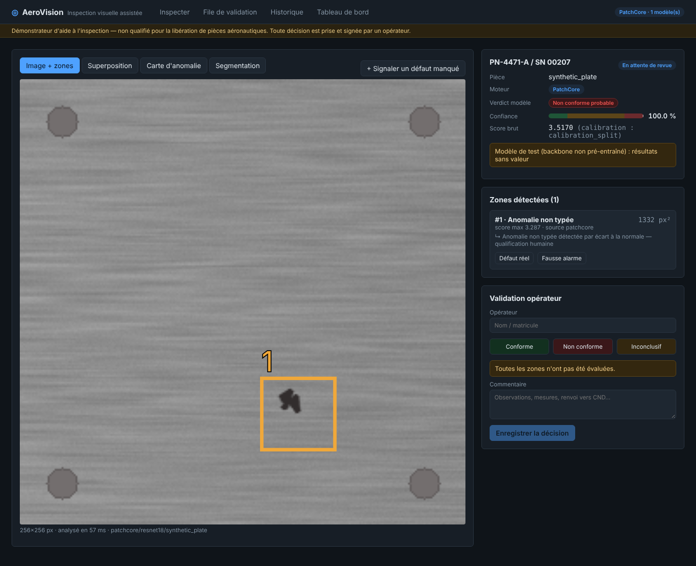
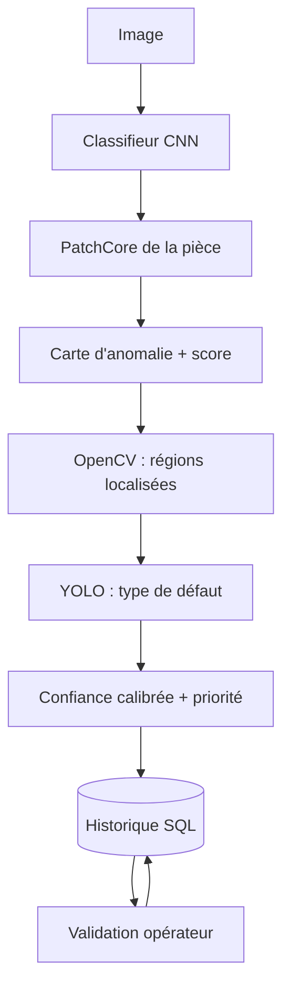

# AeroVision — Inspection automatisée de pièces par Computer Vision

  

**Projet 04 du portfolio** · Python · PyTorch · OpenCV · PatchCore · YOLO · FastAPI · React · Docker

Une caméra photographie une pièce ; AeroVision identifie la pièce, détecte et segmente les
zones anormales, les encadre, leur attribue un score de confiance, puis place l'inspection dans
une file de validation où un opérateur confirme, rejette ou complète le diagnostic. Chaque
décision est tracée et réinjectée pour améliorer le modèle.

> **Cadre** : démonstrateur d'aide à l'inspection entraîné sur des défauts **industriels
> génériques** (MVTec AD). Il n'est ni qualifié ni certifié pour le contrôle de pièces
> aéronautiques. La différence entre les deux est détaillée dans
> [docs/cadre-aeronautique.md](docs/cadre-aeronautique.md).

**Démo en ligne : https://stevvvvvv.github.io/AeroVision/**
(version statique : résultats pré-calculés par les vrais modèles sur des images MVTec AD jamais vues à l'entraînement)



## Fonctionnalités

| Fonctionnalité | Implémentation |
|---|---|
| Classification des pièces | CNN ResNet-18 (transfer learning), route vers le bon modèle d'anomalie |
| Détection de fissures et défauts de surface | PatchCore : apprend la pièce saine, détecte tout écart, y compris des défauts jamais vus |
| Segmentation des zones endommagées | carte d'anomalie au pixel, masque binaire |
| Localisation des anomalies | post-traitement OpenCV (seuil, morphologie, contours) → boîtes et polygones |
| Typage des défauts | YOLOv8-seg (optionnel) sur une taxonomie générique de 11 classes |
| Score de confiance | probabilité calibrée (Platt scaling) + seuil F1 optimal sur un split dédié |
| Historique des inspections | base SQL (SQLite / PostgreSQL), images archivées, filtres |
| Interface de validation humaine | file priorisée, confirmation / rejet par zone, ajout de défauts manqués, décision tracée |
| Suivi qualité | tableau de bord : taux de défauts manqués, concordance modèle / opérateur, précision des zones |
| Boucle d'amélioration | export CSV des retours opérateurs pour ré-entraînement |

## Ce que le projet démontre

- **Computer Vision et Deep Learning** : détection d'anomalies non supervisée (PatchCore codé
  à la main : extraction multi-échelle, coreset k-center, recherche du plus proche voisin),
  classification CNN, détection/segmentation supervisée YOLO.
- **Traitement d'images** : OpenCV pour la localisation, la morphologie, les superpositions, et
  un détecteur classique sans IA servant de point de comparaison.
- **IA industrielle** : calibration honnête, priorité aux faux négatifs, humain dans la boucle,
  traçabilité, distinction explicite entre défaut générique et défaut certifié.
- **Ingénierie logicielle** : API REST typée, front React/TypeScript, tests automatisés,
  Docker Compose.

## Démarrage rapide

### Avec Docker

```bash
docker compose up --build
# Interface : http://localhost:8080 · API : http://localhost:8000/docs
```

Sans modèle entraîné, l'application tourne en **mode OpenCV (sans IA)**, signalé dans
l'interface. Entraîner un modèle (ci-dessous) puis redémarrer le backend active PatchCore.

### En local (Windows, Linux, macOS)

```bash
python -m venv .venv
.venv\Scripts\activate            # Linux/macOS : source .venv/bin/activate
pip install torch torchvision --index-url https://download.pytorch.org/whl/cpu   # ou la variante CUDA
python tasks.py install
python tasks.py test

# 1) Vérifier le pipeline sans dataset (seuls les poids ImageNet sont téléchargés)
python tasks.py train-synthetic

# 2) Sur MVTec AD (à extraire dans data/mvtec_ad/)
python tasks.py train --category metal_nut   # une pièce
python tasks.py train-all                    # les 15 catégories
python tasks.py classifier                   # identification automatique de la pièce
python tasks.py yolo                         # optionnel : typage des défauts (pip install ultralytics)

python tasks.py api      # http://localhost:8000/docs
python tasks.py front    # http://localhost:5173
```

### Démo statique (GitHub Pages)

```bash
python tasks.py export-demo   # passe ~30 images d'évaluation dans les vrais modèles
python tasks.py deploy        # build "demo" + publication sur la branche gh-pages
```

Le front tourne alors sans backend : il lit `frontend/public/demo/` (résultats et images
pré-calculés) et garde les revues opérateur dans le navigateur.

## Architecture



Détails, API et modèle de données : [docs/architecture.md](docs/architecture.md).

## Résultats

Protocole : entraînement sur pièces saines uniquement, calibration des seuils sur 30 % du test,
**évaluation sur les 70 % restants**, jamais vus pendant l'entraînement ni la calibration
(voir [docs/donnees.md](docs/donnees.md)). GPU : NVIDIA RTX 2060.

| Pièce (proxy aéro) | AUROC image | AUROC pixel | Défauts manqués | Fausses alarmes |
|---|---|---|---|---|
| metal_nut (fixation usinée) | 0,997 | 0,989 | 2 / 64 | 0 / 15 |
| screw (visserie) | 0,966 | 0,992 | 4 / 83 | 7 / 29 |
| cable (harnais) | 0,991 | 0,987 | 1 / 64 | 3 / 41 |
| grid (structure ajourée) | 0,997 | 0,985 | 1 / 40 | 1 / 15 |
| transistor (électronique) | 0,998 | 0,973 | 2 / 28 | 0 / 42 |

Classifieur de pièces (ResNet-18) : 100 % de bonne identification sur le test (5 classes
visuellement très distinctes : chiffre attendu, pas une prouesse).

Lecture critique :

- **screw** est la pièce la plus difficile (orientation variable d'une image à l'autre) :
  7 fausses alarmes sur 29 pièces saines. Pour un opérateur, c'est de la charge de revue en plus.
- Les seuils maximisent le F1, compromis entre défauts manqués et fausses alarmes. **En contexte
  aéronautique, ce n'est pas le bon objectif** : on déplacerait le seuil pour viser un taux de
  défauts manqués quasi nul, au prix de davantage de fausses alarmes.
- Les échantillons d'évaluation sont petits (28 à 83 pièces défectueuses par catégorie) : un défaut
  manqué de plus ou de moins change le pourcentage de plusieurs points.

## Structure

```
ml/                      paquet aerovision_ml + scripts d'entraînement
  aerovision_ml/         patchcore, classifier, postprocess, calibration, metrics, taxonomy, baseline
  scripts/               train_patchcore, train_classifier, mvtec_to_yolo, train_yolo, make_synthetic_dataset
  tests/
backend/                 API FastAPI (app/), tests
frontend/                React + TypeScript (Vite), mode démo statique
scripts/                 export_static_demo.py (démo GitHub Pages)
docs/                    architecture, cadre aéronautique, données, fiche modèle, captures
docker-compose.yml
tasks.py                 raccourcis multiplateformes (install, test, train, api, front…)
```

## Données et licences

MVTec AD est sous **CC BY-NC-SA 4.0 (usage commercial interdit)**. Ultralytics YOLO est sous
**AGPL-3.0**. Une version commerciale demanderait d'autres données et un autre détecteur ou une
licence. Détails : [docs/donnees.md](docs/donnees.md).

## Pistes d'évolution

- Tuilage des images haute résolution pour les défauts de quelques pixels.
- Acquisition caméra en direct (OpenCV `VideoCapture`) et contrôle d'éclairage.
- Métrique PRO (per-region overlap) en plus de l'AUROC pixel.
- Ré-entraînement automatique à partir des retours opérateurs, versionnage des modèles (MLflow).
- Authentification et rôles (opérateur, contrôleur niveau 2, administrateur qualité).
- Extension à l'imagerie CND (radiographie, thermographie) sur données appropriées.

## Auteur

Steven Jansen — Mastère Big Data, Développement & IA (IPSSI), ingénieur aéronautique et spatial (IPSA).

Démo : https://stevvvvvv.github.io/AeroVision/
