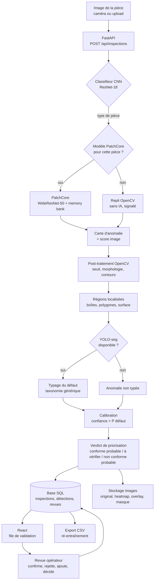
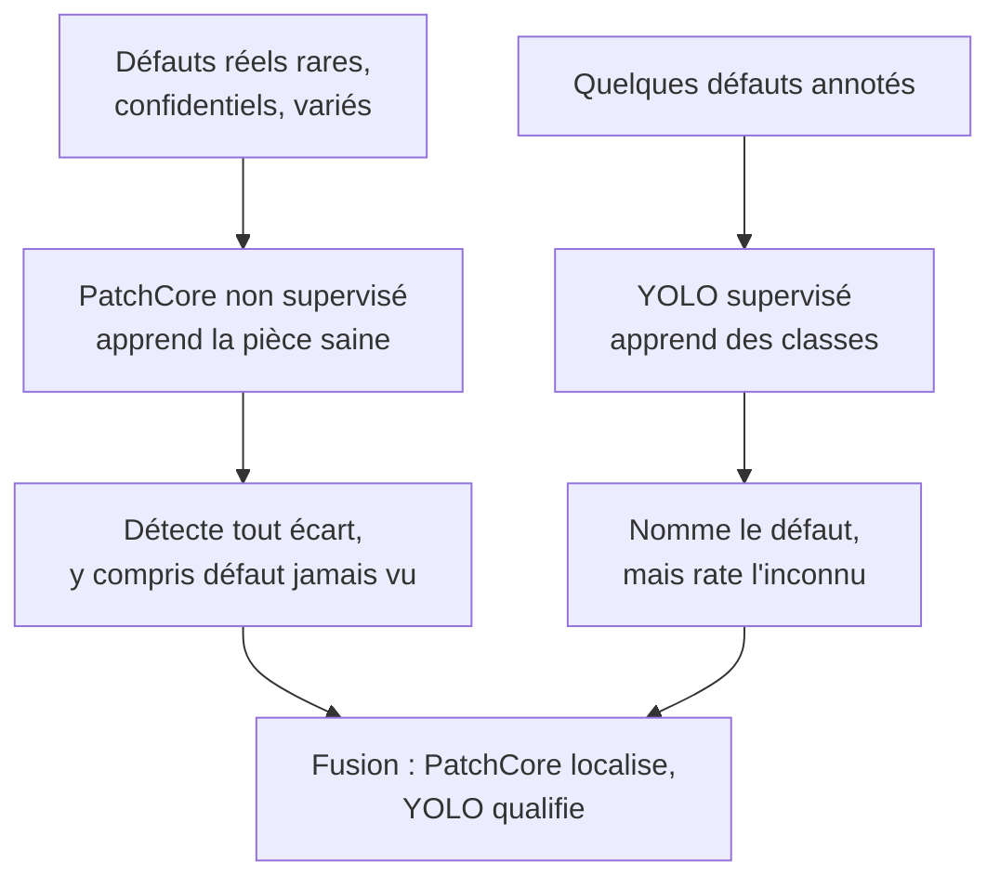
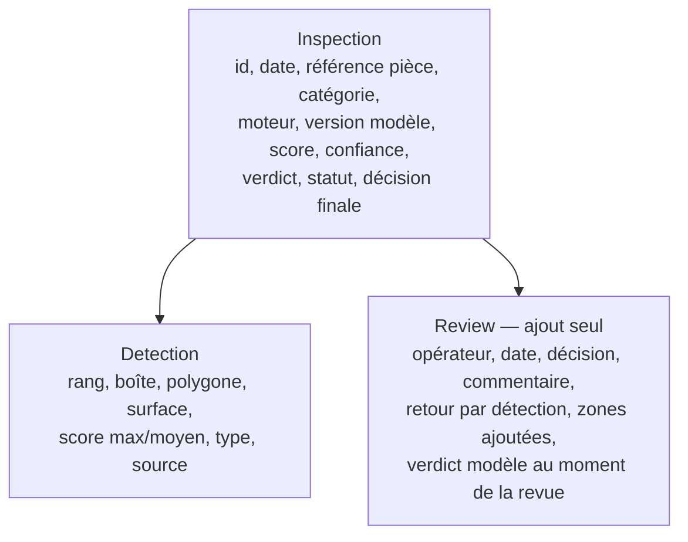

# Architecture

## Chaîne d'inspection

## Pourquoi deux familles de modèles

## Modèle de données

## API

| Méthode | Route | Rôle |
|---|---|---|
| GET | `/api/health` | sonde |
| GET | `/api/system` | modèles chargés, politique de décision, classes |
| POST | `/api/inspections` | inspecter une image (multipart : `file`, `part_reference`, `category`) |
| GET | `/api/inspections` | historique / file (`status`, `verdict`, `category`, `queue=true`) |
| GET | `/api/inspections/{id}` | détail complet |
| GET | `/api/inspections/{id}/image/{original\|heatmap\|overlay\|mask}` | images |
| POST | `/api/inspections/{id}/reviews` | validation humaine |
| GET | `/api/stats` | KPI, concordance modèle / opérateur |
| GET | `/api/export/feedback.csv` | retours opérateurs pour ré-entraînement |

Documentation interactive : `http://localhost:8000/docs`.

## Choix techniques

- **PatchCore plutôt qu'un autoencodeur** : état de l'art robuste sur MVTec AD, pas
  d'entraînement de réseau (seulement extraction + mémoire), donc rapide et reproductible.
- **Un modèle par type de pièce** : reflète la réalité industrielle (chaque référence a sa
  normalité) et garde des mémoires petites.
- **Bornes de normalisation fixes** pour la carte de chaleur : une pièce saine reste « froide »
  au lieu d'être étirée sur toute la palette (piège classique du min/max par image).
- **Revues en ajout seul** : exigence de traçabilité.
- **SQLite par défaut, PostgreSQL par variable d'environnement** (`AEROVISION_DATABASE_URL`).
